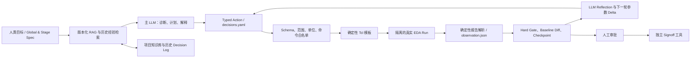

# LLM 大模型辅助芯片后端设计：研究与实践报告

> - 状态：最终版
> - 研究范围：仅限 LLM、大语言模型、RAG、工具调用、Agent、多 Agent、领域适配、代码 Agent 与多模态大模型
> - 资料截止日期：2026-07-12
> - 对应项目：`chip-backend-ai`

## 执行摘要

本报告只研究大语言模型在数字芯片后端设计中的用途，不讨论强化学习、传统机器学习、CNN/GNN、贝叶斯优化、TPE、进化算法、可微分布局或代理预测模型。若某项工作是混合方案，本报告只分析其中由 LLM 承担的部分。

研究结论如下：

1. **LLM 当前最适合做“认知与编排层”，不适合成为物理正确性的最终裁判。**它擅长理解设计意图、检索手册、生成结构化决策、调用工具、分析报告、解释 QoR 变化和组织多轮实验；最终正确性仍应由 Innovus、PrimeTime、PI tools、Calibre 等确定性 EDA 工具及人工签核判断。
2. **最可靠的工程范式不是让 LLM 直接自由生成并执行长 Tcl，而是让它输出受约束的结构化中间表示。**结构化参数经过 schema、范围、单位、版本和命令白名单校验后，再由确定性模板生成 Tcl。
3. **研究前沿正从“问答/脚本生成”转向“工具反馈闭环”和“阶段感知 Agent”。**2025 年的工作重点是 MCP、工具调用与 QoR 反馈；2026 年的新工作进一步引入 checkpoint、历史压缩、阶段专用 skill、全局 Judge 和分支复用。
4. **公开资料中尚未发现经过充分披露、可独立验证的“LLM 无人监督完成完整后端并 tape-out”证据。**产业发布主要证明 Copilot、领域 RAG 和 agentic orchestration 正在进入产品；研究论文主要在 OpenROAD/OpenLane、小规模 benchmark 或选定流程上验证。厂商数字和论文数字均应视为作者口径，在内部真实设计上重新测量。
5. **当前仓库方向基本正确，但生产成熟度仍是 mock 闭环原型。**下一步不应继续扩展更多 stage，而应打通一个真实、可审计、可重跑的 Innovus 纵向闭环：`import → placement → trial route → 报告解析 → LLM 反思与参数调整 → 新 run → baseline 对比`。

## 1. 研究边界

### 1.1 纳入范围

- 通用或领域大语言模型；
- Retrieval-Augmented Generation（RAG）；
- 领域继续预训练、指令微调和 EDA 专用 tokenizer；
- 自然语言到 Tcl、Python、约束和结构化参数的生成；
- Function Calling、MCP、Agent Skills 和工具编排；
- 读取 EDA log、report 和中间结果后的诊断、反思与重试；
- 单 Agent、多 Agent、Judge Agent 和阶段专用 Agent；
- 代码 Agent 修改 EDA 工具或 flow 源码；
- 联合文本、版图图像、热图、表格和电路图的多模态大模型。

### 1.2 明确排除

- 强化学习及 AlphaChip 类布局方法；
- DSO.ai、Cerebrus 等产品中基于 RL/传统 ML 的设计空间优化部分；
- CNN、GNN、普通 Transformer 的拥塞、时序、DRC 或 IR-drop 预测；
- 贝叶斯优化、TPE、bandit、进化算法和其他非 LLM 搜索器；
- surrogate/QoR predictor；
- 可微分 placement、routing 或 gate sizing；
- 仅使用“AI”“生成式 AI”营销措辞、但公开材料无法确认包含 LLM 的功能。

确定性 EDA 执行器、规则校验器、报告解析器、状态机和人工审批仍属于本报告架构，因为它们是约束 LLM 的工程底座，而不是额外的 AI 研究方向。

### 1.3 证据使用原则

- 优先使用论文原文、官方项目仓库、厂商产品页和官方发布稿；
- 区分 peer-reviewed 论文、预印本、研究原型、产品发布和客户案例；
- 所有论文指标均视为作者报告，所有商业指标均视为厂商/客户选定案例，除非另有独立复现；
- 若摘要、正文和实现口径不一致，采用更保守的正文结论并明确不确定性；
- “没有公开证据”只表示本次检索未找到充分披露的材料，不等于证明某能力绝对不存在；
- 不在报告中复制专有手册内容，项目落地时必须遵守手册、PDK 和派生知识的许可证与访问控制。

## 2. LLM 在芯片后端中的能力地图

| 方向 | LLM 输入 | LLM 输出 | 可靠性裁判 | 当前判断 |
|---|---|---|---|---|
| 知识助手 | 手册、命令文档、项目经验、错误案例 | 带引用的回答、命令解释、检查清单 | 来源版本与引用校验 | 最容易落地，近期 ROI 最高 |
| 脚本与约束助手 | 自然语言目标、API/schema、示例 | 参数 IR、Tcl/Python patch、SDC 建议 | schema、lint、工具 dry-run/真实执行 | 可实用，但应避免无约束整段脚本 |
| 报告诊断助手 | log、timing/congestion/IR/DRC 摘要 | 异常分类、根因假设、下一步实验 | 确定性 parser、原始报告、工程师复核 | 高价值，依赖可靠观察层 |
| Tool-using Agent | Spec、知识、上轮 QoR、工具接口 | 工具调用、参数 delta、重试/回滚建议 | EDA run、hard gate、checkpoint | 研究热点，适合单 stage 试点 |
| 阶段感知 Agent | 全局目标、阶段状态、历史树 | 选择回退点、阶段局部决策、跨阶段解释 | post-route/signoff QoR 与人工门 | 2026 前沿，尚需规模化验证 |
| 多 Agent | 同一问题的多个上下文或角色 | 多个候选方案、批评、裁决 | EDA 执行结果优先于 LLM 投票 | 可提高难例覆盖，但成本与相关性失败需评测 |
| 多模态助手 | 布局图、拥塞/IR 热图、表格、文本 | 可解释诊断和设计建议 | 原始数据库、报告、后续 EDA run | 很早期，适合作为解释界面 |
| EDA 代码 Agent | OpenROAD/flow 源码、issue、测试 | 可执行 diff、测试和实验报告 | 编译、回归、benchmark、代码审查 | 新方向，与“使用 EDA 工具”不同 |

## 3. 代表性研究

### 3.1 领域知识、RAG 与脚本生成

| 工作 | 核心贡献 | 公开证据 | 主要边界 | 对本项目的启示 |
|---|---|---|---|---|
| [ChipNeMo](https://research.nvidia.com/publication/2023-10_chipnemo-domain-adapted-llms-chip-design) | 定制 tokenizer、领域继续预训练、SFT 和领域检索，覆盖工程问答、EDA 脚本、bug 总结 | NVIDIA 报告领域适配后，部分任务可由小约 5 倍的模型达到相近或更好效果 | NVIDIA 明确承认结果与理想状态仍有差距；没有证明自主后端闭环 | 先做高质量私有 RAG 和专项评测，再决定是否微调 |
| [ChatEDA](https://arxiv.org/abs/2308.10204) | 将自然语言需求分解为任务，再生成调用 EDA API 的脚本并执行 | 约 1,500 条指令数据；50 个任务 benchmark；论文报告领域模型优于通用模型 | 直接生成脚本，运行时 grounding、回滚和长期状态较弱；benchmark 规模有限 | 可借鉴“plan → script → execute”，但生产实现应改成 typed IR 和确定性模板 |
| [EDA Corpus](https://arxiv.org/abs/2405.06676) | 为 OpenROAD 发布开放许可的问答与脚本数据集 | 超过 1,000 个问答/脚本样本，公开仓库可用于 LLM 研究 | 规模小、集中于 OpenROAD，不能代表商业工具和先进节点 | 可作为公开 eval 起点，不应替代本项目的版本化 Innovus 数据 |
| [EDAid / ChipLlama](https://aclanthology.org/2025.naacl-long.83/) | 多个发散 Agent 生成候选，由决策 Agent 选择；结合推理、代码和 EDA 指令数据 | NAACL 2025；在两个各 50 项的脚本任务 benchmark 上报告明显提升 | 评估重点是脚本任务成功，不等价于完整后端 QoR 或 tape-out；多 Agent 计算开销较大 | 仅在单 Agent 已被实测证明不稳定的难步骤引入并行候选 |

### 3.2 标准工具接口与闭环执行

| 工作 | 核心贡献 | 公开证据 | 主要边界 | 对本项目的启示 |
|---|---|---|---|---|
| [ORFS-agent](https://arxiv.org/abs/2506.08332) | LLM 读取 OpenROAD 配置、日志与 QoR，调用工具并迭代提出下一组配置 | MLCAD 2025；覆盖 6 个电路/节点组合，并提供 without-tool 与 with-tool 变体 | 论文 headline 的约 13% 改善和 40% 少迭代来自含 GP/BO 工具箱的混合配置，不能归因于纯 LLM；研究规模也较小 | 本报告只采纳其 `observe → reason → act → feedback` LLM loop，不把混合系统数字当成 LLM-only 证据 |
| [MCP4EDA](https://arxiv.org/abs/2507.19570) | 通过 MCP 连接 Yosys、仿真、OpenLane、KLayout，并利用实际后端结果反向调整前级脚本 | 在选定开源设计上进行端到端实验 | 预印本；摘要中的改善区间与正文聚合结果口径不一致，且工具链与商业先进节点存在差距，数字不宜直接外推 | 工具能力应通过稳定、窄接口暴露给 LLM，而不是开放任意 shell |
| [AutoEDA](https://arxiv.org/abs/2508.01012) | MCP 微服务、类型化请求、参数校验、任务分解和 Tcl 模板 | 100 个自然语言 prompt；论文报告 CodeBLEU 与 token 效率提升 | 代码相似度仍不等价于真实 QoR；benchmark 偏脚本映射 | 与本仓库最接近：LLM 输出参数，server 校验，模板生成 Tcl，工具返回 JSON QoR |

### 3.3 从流程 Agent 到阶段感知 Agent

| 工作 | 核心贡献 | 公开证据 | 主要边界 | 对本项目的启示 |
|---|---|---|---|---|
| [Retrieve, Schedule, Reflect](https://arxiv.org/abs/2603.13767) | 用 RAG 检索自然语言经验，以 QoR 反馈进行语言反思并调度优化动作 | 2026-03 预印本；作者报告与人工结果接近及执行加速 | 代码和数据在摘要中仍以“将公开”表述；尚缺广泛复现 | 历史经验应成为可检索决策树，而不是把所有 run 原文塞入上下文 |
| [AgenticPD](https://arxiv.org/abs/2607.04758) | Judge Agent 选择历史节点和重新进入的 stage，阶段 Agent 只看局部 context；复用 checkpoint，最终候选均按 post-route QoR 评估 | 2026-07-06 首发、07-08 更新；7 页预印本 | 极新、尚未经过长期复现；公开摘要未证明生产规模或商业节点适用性 | 与仓库 stage/skill/state 结构高度同构；应先实现 run-scoped checkpoint 和压缩 observation，再考虑多 Agent |

### 3.4 多模态和代码 Agent

| 工作 | 核心贡献 | 公开证据 | 主要边界 | 对本项目的启示 |
|---|---|---|---|---|
| [Multimodal Chip Physical Design Engineer Assistant](https://arxiv.org/abs/2510.15872) | 联合布局图像、表格、文本和电路信息，输出拥塞解释与设计建议 | 在 CircuitNet 上进行预测与解释性实验 | 方案还组合了非 LLM 方法；本报告仅考虑多模态大模型的观察和解释层；未证明 signoff 级决策 | 后期可把 layout/heatmap 截图作为辅助证据，但数值应来自结构化数据库和报告 |
| [AuDoPEDA](https://arxiv.org/abs/2601.06268) | Codex 类 coding agent 读取 OpenROAD 仓库、提出改进、提交可执行 diff，并用回归与 QoR 评测 | 2026 预印本；作者报告 wirelength、ECP 和 power 的选定案例改善 | 修改的是 EDA 工具源码，不是直接完成某颗商业芯片后端；结果为作者报告 | 可用于未来改进开源 parser/flow，但不应让 coding agent直接修改生产 EDA 环境 |

## 4. 研究范式的演进

LLM 后端研究大体经历了以下演进：

1. **问答与直接脚本生成**：模型回答工具问题，或一次性生成 Tcl/Python。
2. **领域 grounding**：通过 RAG、领域语料和命令文档减少幻觉。
3. **结构化工具接口**：模型输出 JSON/YAML 或 function call，由 server 校验后执行。
4. **工具反馈闭环**：模型读取真实 EDA 结果，解释失败并提出下一轮参数变化。
5. **阶段感知与 checkpoint**：模型选择从哪个阶段重新进入，复用中间状态并控制上下文规模。
6. **多模态与代码 Agent**：一条路线理解版图和热图；另一条路线直接改进开源 EDA/flow 代码。

最重要的趋势不是模型越来越自由，而是**模型周围的确定性边界越来越清楚**：输入被压缩成结构化 observation，输出被约束成 typed action，执行由工具完成，结果由 hard gate 判断，关键动作由人审批。

## 5. 产业实践与成熟度判断

### 5.1 明确属于 LLM/Agent 范围的产业信号

| 厂商方向 | 公开能力 | 成熟度判断 |
|---|---|---|
| [NVIDIA ChipNeMo](https://research.nvidia.com/publication/2023-10_chipnemo-domain-adapted-llms-chip-design) | 工程问答、脚本生成、bug 总结；领域预训练、SFT、RAG | 有工业内部研究价值，但公开材料不是可购买的自主后端产品 |
| [Synopsys.ai Copilot](https://www.synopsys.com/ai/generative-ai.html) | 工具知识、工作流指导、脚本与内容生成 | Copilot 能力已进入产品线；公开生产率数字为厂商/客户口径，不等同于后端 QoR 保证 |
| [Synopsys AgentEngineer](https://news.synopsys.com/2026-03-11-Synopsys-Outlines-Vision-for-Engineering-the-Future) | 多 Agent 编排、生成、检查、执行与自适应学习 | 2026 官方演示的完整案例重点仍是 RTL、lint、testbench 和 verification；不能视为完整后端无人 tape-out 证据 |
| [Siemens Fuse EDA AI Agent](https://news.siemens.com/en-us/siemens-fuse-eda-ai-agent/) | RAG、多模态 EDA 数据湖、MCP、Agent Skills、多模型；连接 Aprisa P&R/timing/power、Calibre DRC 和 3D-IC 流程 | 2026-03 首发/展示，方向与本项目高度一致；公开资料尚无充分的客户 tape-out 数量和后端 QoR 对照 |

### 5.2 因研究边界而排除的产业项目

以下项目可能有重要产业价值，但不进入本报告的技术结论：

- Synopsys DSO.ai、Cadence Cerebrus：主要公开价值来自 RL/传统 AI 设计空间优化；
- Google AlphaChip：强化学习宏布局；
- Cadence Voltus InsightAI 等只公开表述“生成式 AI”、但资料没有明确说明核心是 LLM 的能力；
- CNN/GNN 或普通深度模型的拥塞、IR、DRC、timing 预测；
- GPU 加速、可微分优化和物理仿真 surrogate。

这种排除不代表这些技术无价值，只是为了保持本报告的 LLM-only 边界。

## 6. 推荐的 LLM 工程架构



架构分工应保持稳定：

- **LLM**：理解、检索、提出假设、选择工具、解释结果；
- **结构化协议**：限制 LLM 可表达的动作；
- **模板与 adapter**：把合法动作翻译成工具命令；
- **EDA 工具**：产生真实设计状态和 QoR；
- **parser 与 gate**：确定性提取、比较和阻止不合格结果；
- **人类**：审批高风险、不可逆和 signoff 决策。

## 7. 最佳实践

### 7.1 RAG 必须版本化、可引用、渐进披露

- 文档按 `tool / release / command / stage / concept` 建索引；
- 每个检索片段保留原始来源、版本、页码或章节；
- 先检索目录和摘要，再按需加载 detail，避免把整份手册塞入上下文；
- 项目经验和厂商手册分库、分权限，防止跨项目泄漏；
- 单独评测 retrieval recall、版本匹配和引用正确性，而不是只看最终回答是否流畅。

### 7.2 LLM 输出 typed IR，不直接拥有任意 Tcl/shell 权限

推荐的 action 至少包含：

```yaml
action_id: placement.adjust_density
tool: innovus
tool_release: "<exact-release>"
stage: placement
parameters:
  target_density: 0.68
rationale:
  observation_refs:
    - placement/run_003/observation.json#congestion.hotspots
  knowledge_refs:
    - innovus/<release>/commands/place_opt
expected_effect:
  improve: congestion
  protect: [setup_timing, hold_timing, area]
rollback_checkpoint: placement/run_002/checkpoint
```

参数需要经过 JSON Schema/Pydantic、范围、枚举、单位、互斥关系和工具版本校验。只有校验通过的 action 才能进入模板；LLM 生成的任意 fragment 默认不得执行。

### 7.3 observation 必须由确定性 parser 生成

不要让 LLM 从巨大的原始日志中自行“找数字”。至少应结构化：

- MMMC view、corner、mode、path group；
- setup/hold WNS、TNS、violating endpoints 和 unconstrained paths；
- max transition/cap/fanout 等 DRV；
- global/detailed routing overflow、热点坐标和层；
- DRC rule、数量、坐标簇和新增/消失 diff；
- static/dynamic IR、PG/signal EM；
- runtime、内存、license、工具退出状态；
- 当前 checkpoint、输入 hash 和 tool/PDK/library 版本。

LLM 应读取压缩摘要和少量相关原文片段；原始报告保留用于审计。

### 7.4 闭环必须显式记录假设和反证

每次迭代落盘：

```text
观察 → 根因假设 → 参数 delta → 预期改善/保护指标
     → 实际 EDA 结果 → 与 baseline/上轮 diff
     → 接受/拒绝 → 新经验或反证
```

停机条件由确定性规则决定，例如预算耗尽、hard gate 失败、连续多轮无有效改善、工具重复失败或需要人类裁决。不要让 LLM 自己宣布“已经收敛”。

### 7.5 单 Agent 默认，多 Agent 按证据启用

本项目当前采用“主 Agent + 决策 skill”而不是自由通信的 sub-agent，这是合理的可靠性默认值。只有当 eval 显示单 Agent 在特定任务上持续失败时，才对以下难步骤引入多候选：

- route DRC repair；
- timing ECO 策略；
- 跨阶段根因归属；
- waiver 解释和风险审查。

即使使用多 Agent，也应由真实 EDA 结果和 hard gate 选择候选，不能只用模型投票。

### 7.6 权限、审计和数据安全是产品功能

建议至少划分：

1. 只读知识与报告；
2. 生成建议和 patch；
3. 启动隔离 run；
4. 修改 working copy；
5. 修改共享 baseline 或提交 signoff。

第 4、5 级必须人工审批。每个调用记录模型、prompt/version、检索证据、工具参数、文件 diff、运行结果和回滚点。PDK、网表、版图、专有手册和历史 tape-out 数据优先在本地或企业受控环境中处理。

## 8. 当前仓库评估

### 8.1 已有优势

1. [`flow_definition.yaml`](../plugins/chip-backend-ai/templates/flow_definition.yaml) 已覆盖 import、floorplan、powerplan、placement、CTS、route、timing ECO、signoff、tapeout，并包含 skill step、人工门和质量 gate。
2. [`render_tcl.py`](../plugins/chip-backend-ai/skills/render-tcl/scripts/render_tcl.py) 已实现 `spec → decisions → workspace paths → override` 的结构化渲染，并拒绝未填占位符。
3. [`state_manager.py`](../plugins/chip-backend-ai/core/workflow/state_manager.py)、[`flow_loader.py`](../plugins/chip-backend-ai/core/workflow/flow_loader.py) 和 [`decision_logger.py`](../plugins/chip-backend-ai/core/workflow/decision_logger.py) 已提供状态、步骤、暂停和审计骨架。
4. [`run-chip-flow`](../plugins/chip-backend-ai/skills/run-chip-flow/SKILL.md) 已要求逐步驱动、真实人工门和禁止自写批量 driver，这对防止 Agent 绕过审批很重要。
5. 知识库已经采用 progressive disclosure，并包含 Innovus / PI tooling 等分层资料。
6. [`run_eda_script.py`](../plugins/chip-backend-ai/skills/run-eda-script/scripts/run_eda_script.py) 对 mock/stub 产物进行显式标记，没有把模拟 QoR 冒充真实结果。

因此，本项目无需推翻重做。其结构已经接近“RAG + typed action + deterministic execution + human gate”的正确范式。

### 8.2 最高优先级缺口

#### P0：实际 LLM 决策尚未成为可回放、可评测的软件组件

当前多个 `gen_decisions.py` 是为了跑通流程而提供的 deterministic baseline；真正的 LLM 判断依赖宿主模型临场加载 decision skill。系统尚未统一保存模型版本、prompt 版本、检索证据、完整 action 输入输出、token/cost 和模型调用 trace，也无法对同一个决策边界稳定回放。

生产化时应把一次 LLM decision 定义为明确的记录对象：

```text
model/prompt/RAG version
+ input observation/evidence hashes
+ typed action or refusal
+ validation result
+ tool execution result
+ human decision
```

deterministic baseline 可以继续作为 fallback 和对照，但不能代表 LLM 能力已经通过测试。

#### P0：命令 grounding 链路没有真正闭环

[`router.py`](../plugins/chip-backend-ai/core/router.py) 的 `search-cmd` 依赖 `processed_eda/<tool>.json`，但当前没有对应的 Innovus command JSON。决策 skill 虽要求检索命令，实际无法获得版本化命令 schema。

应先从获准使用、且与真实工具 release 完全一致的命令参考构建：

- command、syntax、argument type、range、enum、default；
- stage applicability 和冲突关系；
- tool release、来源章节和许可信息；
- 可用于 action schema 和离线 Tcl lint 的机器可读格式。

#### P0：真实 EDA 纵向闭环尚未验证

当前 E2E 主要验证 mock plumbing，并不证明模板能在真实 Innovus 中执行，也不证明报告解析与人工检查一致。应先打通：

```text
真实 Innovus import
→ placement/place_opt
→ trial route
→ timing/congestion 报告
→ observation.json
→ LLM 参数 delta
→ 新 attempt
→ baseline diff
```

执行模式也应改为显式 `real | mock | stub`：`real` 模式缺少工具或产物时必须 fail closed，不能自动生成占位产物继续流程；三种模式不得复用同一个 run 目录。

#### P0：观察层不足以支持 LLM 物理判断

现有 parser 以简单正则为主，缺少 MMMC、path group、单位归一化、worst/分布、DRC 坐标簇、heatmap 和输入 lineage。LLM 即使推理能力很强，也无法从缺失或错误的 observation 得到可靠结论。

#### P0：attempt/checkpoint 尚未成为真正的运行实体

多个尝试仍可能复用固定 report/artifact 路径，旧产物可能影响 resume/retry。应统一使用：

```text
stages/<stage>/<run_id>/
  decisions.yaml
  scripts/
  reports/
  artifacts/
  observation.json
  eval_result.yaml
  checkpoint/
```

每次 retry 必须创建新 attempt，保留旧结果，不得覆盖。

#### P1：历史运行尚未接入 RAG

项目知识库与 flow workspace 目前基本分离。真实 run 应自动沉淀：

- design fingerprint 与输入 hash；
- tool/PDK/library release；
- observation 摘要；
- action/parameter delta；
- QoR 与资源成本；
- 工具失败、人工修改和最终接受/拒绝原因。

检索必须按项目权限和相似条件过滤，不能跨项目泄露。

#### P1：缺少 LLM 专项 eval

当前 E2E 验证流程 plumbing，但还需要独立评测：

- RAG 引用与版本准确率；
- action schema 通过率；
- Tcl 工具接受率；
- 报告诊断正确率；
- 工具调用完成率、恢复率和越权率；
- 模型或 prompt 升级前后的回归。

## 9. LLM-only 实施路线图

### Phase 0：知识 grounding 与评测基线

交付物：

- 版本化 Innovus command DB；
- knowledge chunk citation schema；
- EDA 问答、命令选择、参数提取和错误诊断 eval；
- action JSON Schema 与 Tcl allowlist；
- 模型、prompt、RAG 配置的版本记录。

退出条件：模型能在代表性任务上给出可追溯到正确 release 的答案，且所有 action 都能被确定性校验器接受或明确拒绝。

### Phase 1：单 stage 真实 Tool-use Pilot

优先选择 placement，不先做 macro placement 或 signoff。

交付物：

- 真实 Innovus adapter 和环境健康检查；
- `import → placement → trial route` golden baseline；
- timing/congestion typed observation；
- LLM 只输出白名单参数 delta；
- 每轮独立 run、checkpoint 和自动 diff；
- 人工审批候选方案。

退出条件：相同输入可重复执行，parser 与人工/工具 summary 一致，LLM 不得越过 schema 或修改共享 baseline。

### Phase 2：LLM 反思闭环

交付物：

- `observe → hypothesize → act → execute → compare → reflect` 状态；
- 每次决策的 observation/knowledge 引用；
- 失败分类、回滚和明确停机条件；
- 从历史运行检索相似案例并生成初始建议；
- 与人工 golden flow 的 QoR、工程时间和 token/调用成本对比。

退出条件：Agent 能在限定预算内完成或安全停止；任何失败均可定位到 action、工具调用和报告证据。

### Phase 3：阶段感知闭环

按 placement → CTS → route → timing ECO 扩展：

- 每个阶段使用独立 skill、action schema 和 context；
- 主 Agent 根据全局 QoR 选择从哪个 checkpoint 重新进入；
- 下游结果可形成对上游决策的反证；
- macro/pin、waiver、signoff、tapeout 保留强制人工门。

这一阶段可以借鉴 AgenticPD 的“全局 Judge + 阶段局部 context + checkpoint tree”，但应保持单主 Agent 为默认实现，先评测后再引入并行 Agent。

### Phase 4：多 Agent 与多模态增强

只有在前述闭环有真实数据后才进入：

- 对高失败率步骤并行生成少量互相独立的候选；
- critique Agent 检查知识引用、版本、参数冲突和遗漏保护指标；
- EDA Judge 执行候选并用真实结果选择；
- 将布局截图、拥塞/IR 热图作为辅助上下文；
- 数值真值仍来自数据库和确定性 parser。

### Phase 5：生产治理与多工具 signoff

- 本地/BYOC 模型和项目级访问控制；
- PrimeTime、Quantus、Voltus (or equivalent PI tool)、Calibre/Pegasus 等独立 adapter；
- timing、DRC/LVS、IR/EM 分离 hard gate；
- 模型升级回归、红队测试、prompt injection 防护；
- 审计、回滚、成本配额和高风险审批。

## 10. 推荐的首个项目：LLM Placement Closure Pilot

### 10.1 目标

在一个非敏感、已有人工 golden flow 的 block 上，验证 LLM 能否基于真实 Innovus 结果提出安全、可解释、可执行的 placement 参数调整。

### 10.2 输入

- gate-level netlist；
- SDC/MMMC 配置；
- LEF、lib、RC tech 及 macro collateral；
- 精确的 Innovus/PDK/library release；
- golden Tcl、报告和人工验收阈值；
- 获准进入 LLM 上下文的数据清单。

### 10.3 允许的 LLM 动作

- 检索版本化命令和项目经验；
- 解释 timing/congestion observation；
- 在白名单范围内修改少量 placement 参数；
- 给出预期改善、保护指标和回滚点；
- 请求启动隔离 run；
- 比较本轮与 baseline/上轮结果并生成反思。

禁止：

- 任意 shell；
- 未注册 Tcl command；
- 直接覆盖 golden script、checkpoint 或 shared baseline；
- 修改 SDC、MMMC、power intent 等高影响输入而不经人工审批；
- 自行降低 hard gate 以宣称成功。

### 10.4 验收条件

- 所有回答和 action 可追溯到 observation 与知识来源；
- action schema、命令版本和参数范围 100% 经过确定性校验；
- 报告解析与工程师核对一致；
- run 隔离、可恢复、不覆盖旧产物；
- 最终候选满足全部 hard gate，且相对 golden baseline 没有未批准的退化；
- 失败时能安全停止并保留完整审计链；
- 能量化工程师时间、EDA 运行成本和 LLM token/调用成本。

首个 pilot 的成功标准应是“可信、可重复、不劣化”，而不是预先承诺 PPA 改善。

## 11. 评测体系

| 层级 | 核心指标 | 不应使用的替代指标 |
|---|---|---|
| RAG | retrieval recall、引用准确率、release 匹配率、无依据断言率 | 仅看回答流畅度 |
| Action/IR | schema pass、参数合法率、冲突检测率、越权率 | 仅看 JSON 可解析 |
| Tcl | lint、真实工具接受率、命令版本正确率、side-effect 审计 | 仅用 BLEU/CodeBLEU |
| 诊断 | 指标提取准确率、根因命中、保护指标覆盖、工程师接受率 | 仅让另一个 LLM 打分 |
| Agent | 任务完成率、工具调用错误、恢复率、无效循环、人工介入点 | 只统计“最终回答成功” |
| 后端结果 | hard gate、WNS/TNS、hold、DRV、congestion、DRC、IR/EM、power、area | 单一 proxy 或单一加权分数 |
| 运行成本 | wall time、license-hours、CPU/内存、LLM token/费用、工程时间 | 只统计模型调用费用 |
| 安全 | 未授权写入、数据越界、prompt injection、审批绕过、回滚成功率 | 只做普通功能测试 |
| 可复现性 | 输入 hash、tool/model/prompt 版本、重复运行一致性 | 只保存最终 Tcl |

任何模型、prompt、RAG 索引或工具 release 变更，都应重跑固定 eval 和至少一个真实 smoke flow。

## 12. 风险与控制

| 风险 | 典型表现 | 控制措施 |
|---|---|---|
| 命令幻觉 | 命令不存在、参数属于别的 release | 版本化 command DB、typed tool、真实 lint |
| 上下文饱和 | 手册、日志和历史 run 过多导致遗漏 | 渐进披露、结构化 observation、历史压缩 |
| 错读 MMMC | 把任意匹配值当 worst，遗漏 view/path group | 确定性 per-view parser 与单位归一化 |
| 代理目标投机 | 只改善一个指标而破坏可制造性或可靠性 | hard gate 优先、保护指标、独立 signoff |
| 非确定性 | 同输入得到不同动作 | temperature/seed 记录、typed action、重复评测 |
| 过度信任 | 工程师把解释当物理证明 | 明确“建议/证据/裁判”分层，保留人审 |
| 数据泄露 | PDK、网表、版图或手册进入公共服务 | 本地/BYOC、ACL、脱敏、项目隔离 |
| Prompt injection | 文档或 log 中的文本诱导越权调用 | 数据/指令分离、tool policy、内容净化 |
| 审批绕过 | Agent 批量循环跨过人工门 | 每步 driver、不可脚本化 human gate、审计 |
| 模型漂移 | 升级后知识、工具调用或风格退化 | 固定 eval、模型/prompt 版本化、灰度发布 |

## 13. 后续研究问题

本项目值得继续研究、且仍严格属于 LLM 范围的问题包括：

1. 如何把 MMMC timing、拥塞、DRC、IR/EM 组织成既不丢信息、又不撑爆上下文的 observation？
2. 如何让历史 run 通过 RAG 产生可迁移经验，同时避免跨项目和跨节点误用？
3. LLM 的根因解释如何做证据校准，何时必须主动升级给人类？
4. 单主 Agent 与多 Agent 在后端长链任务上的真实可靠性、成本和失败相关性如何比较？
5. 如何将版图/热图视觉信息与数据库数值对齐，避免“看图讲故事”？
6. 如何建立跨 Innovus release、跨工具的稳定 typed tool 接口？
7. 如何让 checkpoint tree、decision log 和 RAG memory 形成可审计的长期工程经验？
8. 如何评测 coding agent 对 EDA/flow 源码的改动，防止局部 benchmark 改善造成全局回归？

## 14. 最终结论

LLM 对芯片后端最现实的价值不是取代物理算法，而是把分散的知识、脚本、报告、经验和工具调用连接成一个可解释、可审计的工程闭环。

对 `chip-backend-ai`，推荐优先级为：

1. 版本化 RAG 与 command grounding；
2. typed action、参数校验和确定性 Tcl；
3. 真实 placement tool-use pilot；
4. typed observation 与 LLM reflection；
5. run-scoped checkpoint 和历史经验 RAG；
6. 阶段感知 Agent；
7. 经评测后再引入多 Agent 和多模态；
8. 最后扩展到多工具 signoff 和生产治理。

核心原则可以概括为：

> **LLM 负责理解、提出假设和编排；结构化协议负责限制动作；EDA 工具负责给出事实；hard gate 和人类负责最终决定。**

## 参考资料

- NVIDIA Research, [ChipNeMo: Domain-Adapted LLMs for Chip Design](https://research.nvidia.com/publication/2023-10_chipnemo-domain-adapted-llms-chip-design)
- He et al., [ChatEDA: A Large Language Model Powered Autonomous Agent for EDA](https://arxiv.org/abs/2308.10204)
- OpenROAD Assistant, [EDA Corpus](https://arxiv.org/abs/2405.06676)
- Wu et al., [Divergent Thoughts toward One Goal: LLM-based Multi-Agent Collaboration System for EDA](https://aclanthology.org/2025.naacl-long.83/)
- Ghose et al., [ORFS-agent: Tool-Using Agents for Chip Design Optimization](https://arxiv.org/abs/2506.08332)
- Wang et al., [MCP4EDA](https://arxiv.org/abs/2507.19570)
- Lu et al., [AutoEDA](https://arxiv.org/abs/2508.01012)
- Tsai et al., [Multimodal Chip Physical Design Engineer Assistant](https://arxiv.org/abs/2510.15872)
- Ghose et al., [Automated QoR Improvement in OpenROAD with Coding Agents](https://arxiv.org/abs/2601.06268)
- Ouyang et al., [Retrieve, Schedule, Reflect: LLM Agents for Chip QoR Optimization](https://arxiv.org/abs/2603.13767)
- Ren et al., [AgenticPD: A Stage-Aware Agentic Framework for Physical Design QoR Optimization](https://arxiv.org/abs/2607.04758)
- Synopsys, [Generative AI for Chip Design](https://www.synopsys.com/ai/generative-ai.html)
- Synopsys, [AgentEngineer / Converge 2026 Announcement](https://news.synopsys.com/2026-03-11-Synopsys-Outlines-Vision-for-Engineering-the-Future)
- Siemens, [Fuse EDA AI Agent](https://news.siemens.com/en-us/siemens-fuse-eda-ai-agent/)
